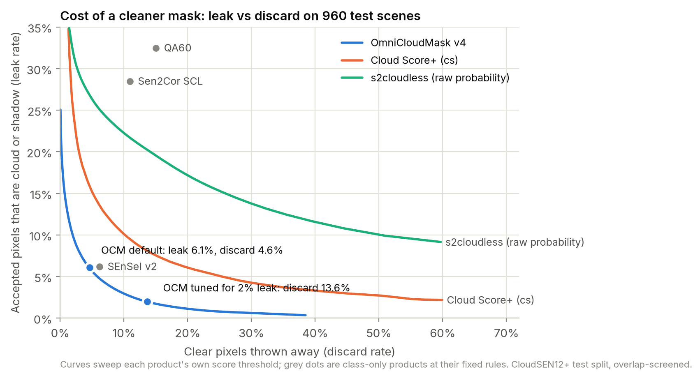
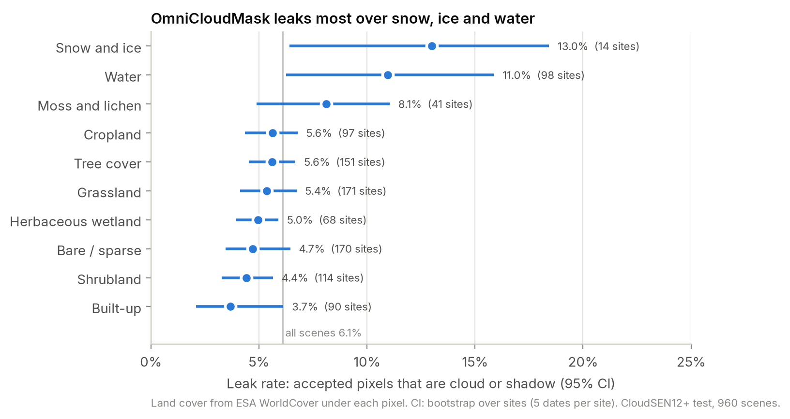
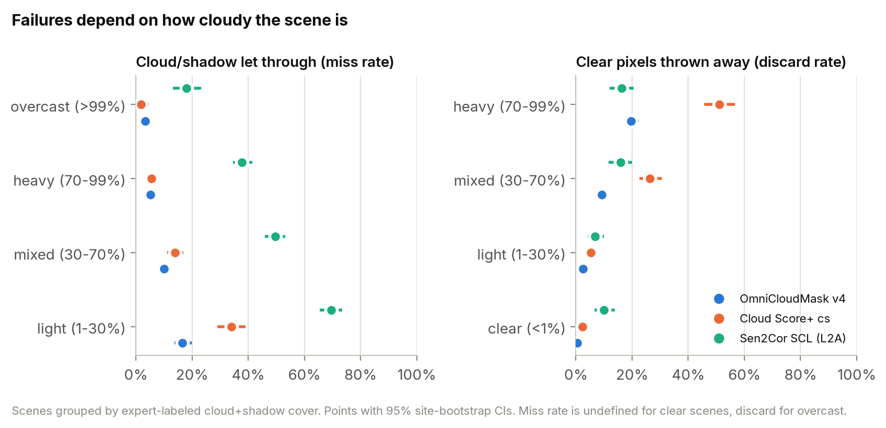
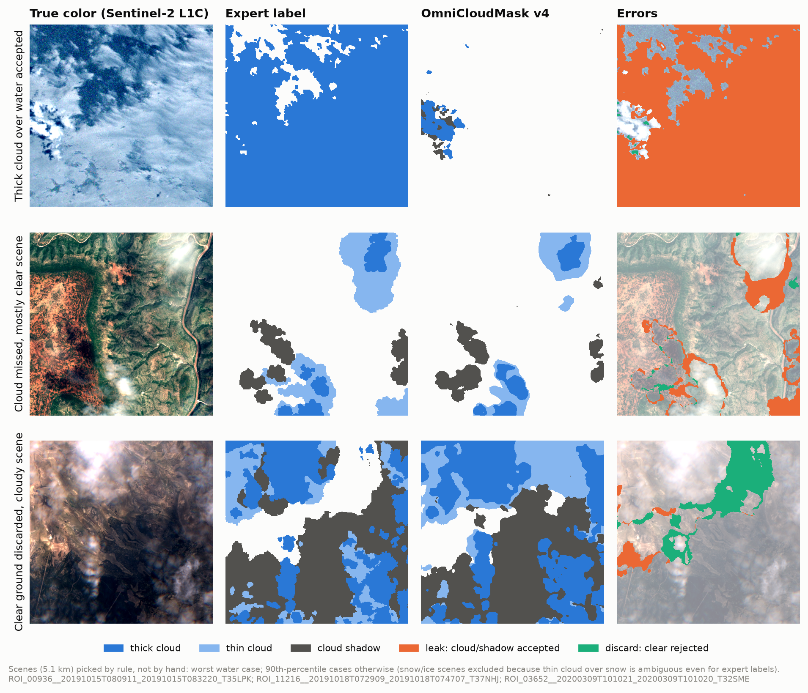
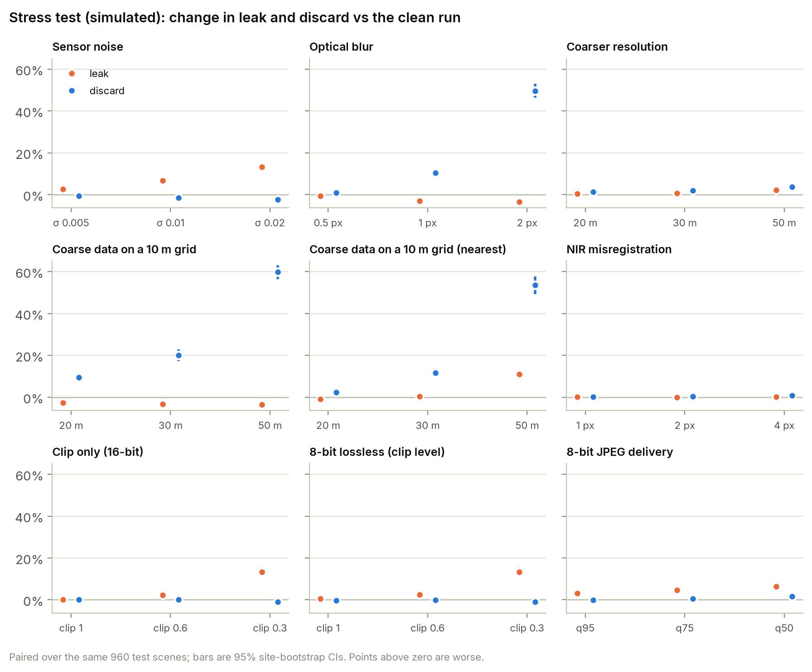

# Cloud-mask acceptance audit: OmniCloudMask v4

An independent assurance audit of [OmniCloudMask](https://github.com/DPIRD-DMA/OmniCloudMask)
(v4 weights, MIT), an open cloud and cloud-shadow segmentation model for Sentinel-2 and
other 10-50 m imagery, run the way a client would commission it: **before you automate on this
mask, how much cloud leaks into the pixels you accept, how much usable ground do you throw
away, and where does it fail?**

Every number below is computed by this repository from public data; nothing is typed in by
hand. The client-style report is in [`report/`](report/).

## Why this matters

Almost every optical imagery pipeline starts by deciding which pixels and which scenes to
use. Cloud and shadow that slip through become false change, wrong indices and bad training
data; clear ground that gets masked is lost revisit. The decision is usually made by a mask
nobody has measured on the buyer's own terms.

## What was tested

- **Model:** OmniCloudMask v4 (two U-Nets, red/green/NIR input), fp32.
- **Data:** CloudSEN12+ (CC0), expert-labeled test split: **960 scenes at 192
  sites**, 509 x 509 px at 10 m, both L1C and L2A. The validation split is used only to choose
  operating points and the buffer size.
- **Training-overlap screen:** OmniCloudMask's published training set includes CloudSEN12
  scribble and 2k patches from *all* splits, so the evaluation scenes were checked against its
  training records (100,528 rows, pinned revision): 0 shared scene
  ids (including 2,754 test/validation-tagged training rows),
  0 shared acquisitions, and 10 evaluation images whose
  footprint may overlap a custom training scene (conservative disc around its named centre)
  were removed. Kappaset names only its ~110 km tile; removing the 50
  test images on those tiles gives leak 6.2% (headline 6.1%). This is a
  screen with stated limits, not proof that no overlap remains.
- **Baselines** (as shipped with CloudSEN12+): Sentinel-2 QA60, Sen2Cor SCL, s2cloudless
  (upstream default post-processing), Cloud Score+, UnetMobV2 and SEnSeI v2. UnetMobV2 was
  trained on CloudSEN12 itself, so it is in-domain like OmniCloudMask.
- **Metrics, framed as the decision:** *leak* = share of accepted (called clear) pixels that
  are cloud or shadow; *discard* = share of truly clear pixels thrown away; *miss* = share of
  cloud/shadow pixels accepted. Every method is scored on the same pixels; abstentions count as
  discarded. Scene policy: keep a 5.1 km patch if its estimated cloud+shadow cover is at most 10%.
- **Statistics:** 95% CIs by bootstrap over sites (5 dates per site are not independent);
  method comparisons are paired.

## Results

**Headline (test, L1C):** leak **6.1%** [5.3, 7.0], discard
**4.6%** [4.0, 5.3], balanced accuracy 0.942 [0.936, 0.947].

| Mask | Leak | Discard | Balanced acc. |
|---|---|---|---|
| OmniCloudMask v4 | 6.1% | 4.6% | 0.942 |
| SEnSeI v2 | 6.2% | 6.2% | 0.934 |
| UnetMobV2 v2 (in-domain) | 7.1% | 5.3% | 0.933 |
| Cloud Score+ (cs >= 0.60) | 8.5% | 12.7% | 0.891 |
| s2cloudless (upstream defaults) | 23.2% | 7.0% | 0.808 |
| Sen2Cor SCL | 28.5% | 10.9% | 0.747 |
| QA60 | 32.5% | 15.0% | 0.696 |

Paired against OmniCloudMask: SEnSeI v2 leak +0.1 pp
[-0.4, 0.6], discard +1.6 pp
[0.9, 2.2]; Sen2Cor SCL leak +22.4 pp
[21.0, 23.8].



**Operating points** (chosen on validation, reported on test). For a 2% leak target,
OmniCloudMask: accept if P(clear) ≥ 0.8529, giving leak 2.0% [1.4, 2.6]
and discard 13.6% [12.4, 14.9]; Cloud Score+ discards
59% at the same target. Thresholding s2cloudless's *raw* probability (no
averaging or dilation) never gets leak below 7.2%; it has no shadow class.

**Where it fails** (real data):





**Stress test (simulated):** change versus the clean run, paired over the same scenes;
n.s. = 95% CI includes zero. Degradations are simple, controlled simulations; they show
sensitivity to each change, not the behaviour of a particular sensor or pipeline.



| Degradation | Effect by severity |
|---|---|
| Sensor noise | σ 0.005: leak +2.6 pp, discard -0.7 pp · σ 0.01: leak +6.7 pp, discard -1.4 pp · σ 0.02: leak +13.2 pp, discard -2.3 pp |
| Optical blur | σ 0.5 px: leak -0.6 pp, discard +0.9 pp · σ 1 px: leak -2.9 pp, discard +10.5 pp · σ 2 px: leak -3.5 pp, discard +49.5 pp |
| Coarser resolution | 20 m: leak +0.4 pp, discard +1.2 pp · 30 m: leak +0.7 pp, discard +2.0 pp · 50 m: leak +2.2 pp, discard +3.6 pp |
| Coarse data on a 10 m grid | 20 m: leak -2.7 pp, discard +9.4 pp · 30 m: leak -3.3 pp, discard +20.0 pp · 50 m: leak -3.5 pp, discard +59.8 pp |
| Coarse data on a 10 m grid (nearest) | 20 m: leak -1.0 pp, discard +2.3 pp · 30 m: leak +0.4 pp (n.s.), discard +11.7 pp · 50 m: leak +11.0 pp, discard +53.7 pp |
| NIR misregistration | 1 px: leak +0.1 pp (n.s.), discard +0.1 pp · 2 px: leak +0.0 pp (n.s.), discard +0.4 pp · 4 px: leak +0.1 pp (n.s.), discard +0.9 pp |
| Clip only (16-bit) | clip 1: leak +0.0 pp, discard +0.0 pp (n.s.) · clip 0.6: leak +2.3 pp, discard +0.1 pp (n.s.) · clip 0.3: leak +13.3 pp, discard -0.9 pp |
| 8-bit lossless (clip level) | clip 1: leak +0.5 pp, discard -0.2 pp · clip 0.6: leak +2.4 pp, discard -0.1 pp (n.s.) · clip 0.3: leak +13.3 pp, discard -1.0 pp |
| 8-bit JPEG delivery | q95: leak +3.1 pp, discard -0.1 pp (n.s.) · q75: leak +4.6 pp, discard +0.5 pp (n.s.) · q50: leak +6.3 pp, discard +1.6 pp |

Coarser data, absolute leak / discard against the 10 m expert label (clean 10 m run:
6.1% / 4.6%). *Native grid*: OCM runs on the coarse pixels.
*10 m grid*: the same coarse data put on a 10 m grid first (bilinear, or nearest-neighbour as a
control). *Majority-label reference*: the expert label reduced to that grid by 4-class block
majority, showing what the coarser grid alone changes (a reference, not a bound on these
metrics).

| Grid | OCM, native grid | OCM, 10 m grid (bilinear) | OCM, 10 m grid (nearest) | Majority-label reference |
|---|---|---|---|---|
| 20 m | 6.5% / 5.9% | 3.4% / 14.0% | 5.1% / 7.0% | 0.7% / 0.1% |
| 30 m | 6.8% / 6.6% | 2.8% / 24.6% | 6.5% / 16.3% | 0.6% / 0.6% |
| 50 m | 8.3% / 8.3% | 2.6% / 64.5% | 17.1% / 58.3% | 1.1% / 1.0% |

## Findings and recommendations

Severity: **High** affects a default decision path with a large error measured on real data;
**Medium** is a material error in a common condition on real data, a trade-off the client must
set, or a large simulated effect on a common processing path; **Low** has limited evidence or
moderate simulated effects; **Info** was checked with small or no measured effect.

| Severity | Finding | Recommendation |
|---|---|---|
| High | Scene filters built on the Sen2Cor SCL band keep cloudy scenes | Gate on OmniCloudMask-derived cover instead of the SCL band. Measured: cloud+shadow inside kept patches after masking falls from 3.4% to 1.6% [0.7, 2.6]. Full-granule filtering was not tested. |
| Medium | At its default setting, about 6% of accepted pixels are cloud or shadow | For leak-sensitive uses (time series, change detection): accept if P(clear) ≥ 0.8529 (chosen on the validation split for a 2% leak target). Test: leak 2.0% [1.4, 2.6] at 13.6% discard. Buffering the mask is the weaker lever: none of the tested buffers (0 to 8 px) met the target; 8 px leaks 3.6% at 13.1% discard. |
| Medium | Coarse data resampled onto a finer grid is over-masked (simulated) | Where the pipeline allows, run the mask on the sensor's native grid and resample the mask. If imagery must be resampled to a finer grid first, validate the mask on that product; real resamplers and sensor optics differ from this simulation. |
| Medium | Clipping bright reflectance lets cloud through (simulated) | Feed unclipped reflectance; avoid running the mask on stretched visual products. |
| Medium | Higher leak over water (11.0% vs 6.1% overall) | For coastal, inland-water and flood work, spot-check a local sample; the stricter threshold above was not validated separately for water. |
| Medium | Small amounts of cloud are missed in mostly clear scenes | The threshold recommendation reduces leak overall; it was not tuned for this regime separately. |
| Medium | Usable ground is discarded in heavily clouded scenes | If gap-filling from cloudy scenes matters, validate a lower threshold for that regime (not tested here). |
| Low | Snow and ice: highest observed leak, weakest evidence | Validate locally before relying on the mask in snow-covered regions. |
| Low | Added sensor noise increases leak (simulated) | Re-validate before using the mask on noisier imagery than Sentinel-2. |
| Info | Small measured effects within the tested range | None required within these ranges; larger shifts or other calibration errors were not tested. |

## Limitations

- CloudSEN12+ labels are expert-drawn but not perfect. Thin cloud over snow and cloud edges are
  the least certain; some measured leak there may be label disagreement (not adjudicated here).
- The test split is cloudier than a typical archive (mean cover ~47%); per-regime results are
  reported so they can be reweighted to a client's own cloud climatology.
- Only Sentinel-2 is tested. OmniCloudMask claims sensor-agnostic use (Landsat, PlanetScope);
  that claim is not evaluated here.
- Scene-filter results are for 5.1 km patches and cloud plus shadow, not full granules.
- Recommendations for specific conditions (water, cloudy scenes) were not validated separately.
- QA60 values in CloudSEN12+ appear shifted (16384/32768 instead of bits 10/11); decoding was
  verified against labels, not against a source document.

## Run it

Requires `uv` and ~4 GB of disk for data plus ~7 GB for the Python environment (PyTorch with
CUDA). An NVIDIA GPU is used when present (an RTX 2070 Super runs everything in ~1.5 h); the
scripts fall back to CPU, which is much slower.

```bash
uv sync --frozen
make all          # download, screen, predict, evaluate, stress test, figures, docs
make test         # unit tests only
```

Data are read by HTTP range requests from pinned dataset revisions, and the model weights are
checked against recorded SHA-256 hashes (`results/provenance.json`). The full run log from a
clean clone is in `results/clean_run.log`.

## Licenses

| Item | License | Source |
|---|---|---|
| This repository's code | MIT | `LICENSE` |
| OmniCloudMask code and v4 weights | MIT | github.com/DPIRD-DMA/OmniCloudMask, huggingface.co/NickWright/OmniCloudMask |
| CloudSEN12+ (images, labels, baseline masks) | CC0 1.0 | huggingface.co/datasets/tacofoundation/cloudsen12 |
| Sentinel-2 imagery | Copernicus open licence: "Contains modified Copernicus Sentinel data [2018-2020]" | dataspace.copernicus.eu/terms-and-conditions |
| ESA WorldCover (land cover layer) | CC BY 4.0: "© ESA WorldCover project 2020 / Contains modified Copernicus Sentinel data (2020) processed by ESA WorldCover consortium" | esa-worldcover.org |
| Cloud Score+ (baseline layer) | CC BY 4.0, Google | developers.google.com/earth-engine/datasets/catalog/GOOGLE_CLOUD_SCORE_PLUS_V1_S2_HARMONIZED |
| OmniCloudMask training metadata (filenames only) | CC BY 4.0 | huggingface.co/datasets/NickWright/OmniCloudMask-Combined-Training-Dataset |
| Inter typeface (report and figures) | SIL OFL 1.1 | github.com/rsms/inter |

CloudSEN12+ also ships a Copernicus DEM layer; this audit does not download or use it. Python
dependencies and their versions are pinned in `uv.lock`.

---
Built 2026-10-27 by Shane Cairns. Generated by `scripts/build_docs.py`.
